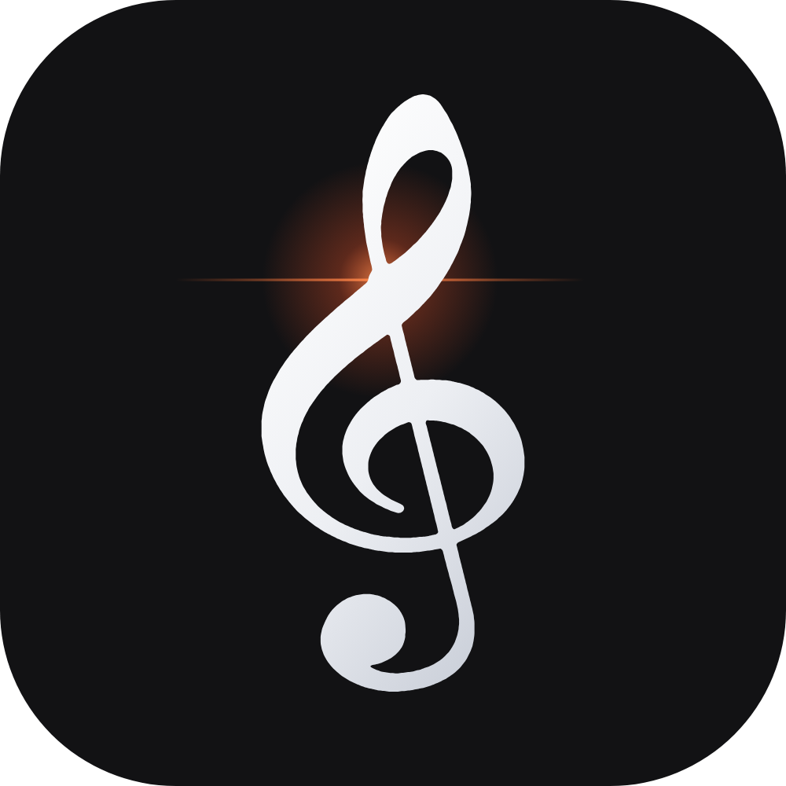

# ClefTune

### Open-source YouTube Music for your desktop

An open source privacy-conscious YouTube Music client for **Windows, macOS, and Linux**: with ad-free playback, gapless transitions, synced lyrics, offline caching, and music that keeps playing after you close the window.

  
  
  
   
  
  
  

**Read Indexes:** [Download](#-installation) · [Features](#-features) · [Sign in](#-signing-in-optional) · [Development](#-development) · [Architecture](#-architecture)

> [!NOTE]
> ClefTune is an open source project. It is **not affiliated with YouTube, Google, or Any third-party applications**. ClefTune communicates with YouTube's internal APIs. YouTube's Terms of Service do not allow this, so use ClefTune for personal listening at your own risk.

## 🤔 Why ClefTune?

ClefTune is built for people who want a focused music player instead of another browser tab:

- **Music that keeps playing**: closing the app window or browser tab does not stop playback.
- **Fast starts**: upcoming and hovered tracks are resolved in advance for near-instant playback.
- **Synced lyrics**: karaoke-style lyrics with click-to-seek and per-song timing adjustments.
- **No setup required**: installers include the runtime, FFmpeg, and everything needed to play music.
- **Optional account support**: sign in through your own browser when you want synced likes, playlists, or history.
- **Desktop-native controls**: media keys, tray integration, themes, and Linux MPRIS support.

## 🎼 Installation 

Download the latest installer from the [Releases](https://github.com/ettisafxrup/ClefTune/releases) page.

| Platform          | Download                                                                                | Install                                                                                           |
| ----------------- | --------------------------------------------------------------------------------------- | ------------------------------------------------------------------------------------------------- |
| **Windows 10/11** | `ClefTune-<version>-windows-x64-setup.exe`                                              | Double-click the installer. Administrator access is not required.                                 |
| **macOS 11+**     | `ClefTune-<version>-macos-arm64.pkg` for Apple Silicon or `-macos-x86_64.pkg` for Intel | Open the package. If macOS blocks it, use **System Settings → Privacy & Security → Open Anyway**. |
| **Linux**         | `ClefTune-<version>-linux-x86_64.run`                                                   | Run `chmod +x ClefTune-*.run && ./ClefTune-*.run`. Root access is not required.                   |

During installation, choose how ClefTune should open:

- **Dedicated Window** _(recommended)_: adds a small native window wrapper.
- **Web Browser View**: smaller installation; opens the player in your browser.

You can change this later in **Settings → Window**. Run the installer again to update, change, or remove the window wrapper.

<b>Uninstalling</b>

- **Windows:** **Settings → Apps → ClefTune → Uninstall**.
- **macOS:** run `/Library/Application Support/ClefTune/Uninstall ClefTune.command`.
- **Linux:** run the installer again and choose **Uninstall**, or run `~/.local/lib/cleftune/uninstall.sh`. Add `--purge` to remove your library as well.

Downloaded music in `Music/ClefTune` is never removed automatically.

## 🎧 Features

| Area                     | Included                                                                                                                        |
| ------------------------ | ------------------------------------------------------------------------------------------------------------------------------- |
| **Browse**               | Home feed, charts, moods and genres, new releases, videos, albums, artists, playlists, and radio mixes                          |
| **Search**               | Live suggestions, type filters, top results, popularity ranking, and duplicate removal                                          |
| **Playback**             | Shuffle, repeat, gapless repeat-one, queue reordering, autoplay radio, sleep timer, and session restore                         |
| **Now Playing**          | Full-screen player with blurred artwork, dedicated controls, seek bar, and lyrics                                               |
| **Lyrics**               | LRCLIB → YouTube Music → KuGou fallback chain, plain-text fallback, word timing, click-to-seek, auto-scroll, and timing offsets |
| **Library**              | Liked songs, playlists, saved albums/artists/playlists, listening history, and 30-day statistics                                |
| **Offline listening**    | Recent-song cache plus permanent downloads in `Music/ClefTune`                                                                  |
| **Account** _(optional)_ | YouTube Music likes, playlists, and history with two-way like synchronization                                                   |
| **Desktop integration**  | Media keys, Linux MPRIS, tray icon, album-art colors, and dark/light/system themes                                              |

### 🤾🏻‍♂️ Player behavior

| Action                                          | Result                          |
| ----------------------------------------------- | ------------------------------- |
| Click album artwork                             | Open **Now Playing** and lyrics |
| Click the artwork again or press <kbd>Esc</kbd> | Return to the previous view     |
| Click a song title                              | Open the song's album           |
| Click an artist name                            | Open the artist page            |
| Close the window or browser tab                 | Keep playback running           |
| Select **Quit** in the sidebar or tray menu     | Stop ClefTune completely        |

## 🔐 Signing in (for better recommendations)

Open **Settings → Account** and choose **Sign in with Google · via your browser**.

1. ClefTune opens the sign-in flow in your normal browser, never in an embedded login window.
2. Sign in as usual, or reuse an existing YouTube login.
3. ClefTune detects the completed login automatically within a few seconds.

You can choose Firefox, Chrome, Edge, Brave, Chromium, Opera, Vivaldi, Safari, or another installed browser. 
The **Advanced** option also accepts request headers copied from browser developer tools.

<b>Additional Data:</b>
> [!IMPORTANT]
> Windows Chrome and Edge encrypt their cookies in a way that other apps cannot always read. If sign-in through either browser fails, try Firefox or the **Advanced** option.

> [!TIP]
> Login data is stored locally in `browser_auth.json` inside the library folder. Enable **Use account for playback** if you need age-restricted songs or Premium audio quality. But it might not work due to strict Youtube rules. 

## ⌨️ Keyboard shortcuts

| Shortcut                    | Action               | Shortcut                                       | Action            |
| --------------------------- | -------------------- | ---------------------------------------------- | ----------------- |
| <kbd>Space</kbd>            | Play / pause         | <kbd>↑</kbd> <kbd>↓</kbd>                      | Volume            |
| <kbd>←</kbd> <kbd>→</kbd>   | Seek 5 seconds       | <kbd>Shift</kbd> + <kbd>←</kbd> <kbd>→</kbd>   | Previous / next   |
| <kbd>L</kbd>                | Like                 | <kbd>S</kbd> / <kbd>R</kbd>                    | Shuffle / repeat  |
| <kbd>Q</kbd> / <kbd>Y</kbd> | Queue / lyrics panel | <kbd>/</kbd> or <kbd>Ctrl</kbd> + <kbd>F</kbd> | Search            |
| <kbd>M</kbd>                | Mute                 | <kbd>Esc</kbd>                                 | Leave Now Playing |

## 🛠 Troubleshooting

<b>What to do when Songs stop loading?</b>

   
YouTube changes its delivery systems regularly. Open:  
- Settings → About → Update YouTube engine  
ClefTune downloads the newest yt-dlp release, verifies its SHA-256 checksum, tests the import, and applies it after restart. Use bundled engine returns to the packaged version.

## 📂 Data locations

This one is a little bit critical for non-tech users of Cleftune, but we are mentioning this for on our clarity.

| Data                     | Windows                            | macOS                                                    | Linux                     |
| ------------------------ | ---------------------------------- | -------------------------------------------------------- | ------------------------- |
| Application              | `%LOCALAPPDATA%\Programs\ClefTune` | `/Applications`, `/Library/Application Support/ClefTune` | `~/.local/lib/cleftune`   |
| Library, settings, login | `%LOCALAPPDATA%\ClefTune`          | `~/Library/Application Support/ClefTune`                 | `~/.local/share/cleftune` |
| Cache                    | `…\ClefTune\cache`                 | `~/Library/Caches/ClefTune`                              | `~/.cache/cleftune`       |
| Downloads                | `Music\ClefTune`                   | `~/Music/ClefTune`                                       | `~/Music/ClefTune`        |

Logs are stored as `cleftune.log` and `window.log` in the library folder.

## 📜 License and Credit Mentions

ClefTune is released under the **GNU General Public License v3.0**. See [LICENSE](LICENSE) for the full text.

ClefTune builds on:

- [ytmusicapi](https://github.com/sigma67/ytmusicapi) → MIT
- [yt-dlp](https://github.com/yt-dlp/yt-dlp) → Unlicense
- [PyAV](https://github.com/PyAV-Org/PyAV) / FFmpeg → BSD / LGPL
- [miniaudio](https://github.com/irmen/pyminiaudio) → MIT
- [pywebview](https://github.com/r0x0r/pywebview) → BSD
- [PySide6](https://doc.qt.io/qtforpython-6/) → LGPL
- [LRCLIB](https://lrclib.net)
- Material Design icons → Apache 2.0

Made 🎼 with 🤍 for people who just want to listen |  @ettisafxrup

